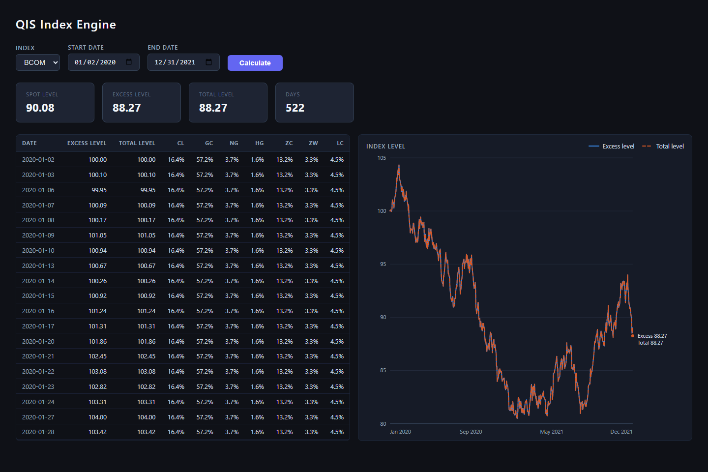

# python23

Python learning projects. The main one is **QIS Engine**, a commodity futures index
calculation and backtesting library with a REST API and a web UI.



---

## QIS Engine

QIS Engine follows the methodology of the GSCI (production-weighted) and BCOM
(liquidity-weighted) commodity indices. For each business day it splits the index
return into spot, roll and collateral parts, then builds spot, excess and total
return levels.

**Features**

- **Index calculation**: daily spot, roll and collateral returns, and spot, excess and total levels
- **Weighting strategies**: equal, production (GSCI-style), liquidity (BCOM-style), risk parity, with min/max weight constraints
- **Roll algorithms**: fixed roll calendar, open-interest trigger, momentum
- **Backtesting**: Polars simulator with commission and slippage costs and risk metrics (Sharpe, Sortino, Calmar, max drawdown, VaR/CVaR)
- **Daily fixing**: preliminary and final fixes with validation checks
- **Options**: Black-76 pricing, greeks, vanna and volga
- **Interfaces**: FastAPI REST API, single-page web UI, Docker image

### Quick start

Requires Python 3.10+.

```bash
git clone https://github.com/code23code23/python23.git
cd python23

# Options pricing loads Black-76 from optlib, which must sit next to qis/
git clone https://github.com/BartolomeD/optlib.git

cd qis
pip install -e ".[dev]"
```

### Run the web UI

```bash
cd qis/qis_engine_ui
python -m uvicorn main:app --reload --port 8080
```

Open http://localhost:8080, choose an index (BCOM or GSCI) and a date range, then
click **Calculate**. The results table is on the left and the chart of excess and
total level is on the right. Hover over the chart to see the values for a given day.

> With the bundled stub data the collateral rate is 0, so excess level and total
> level are identical and their lines overlap. Total level is drawn dashed so both
> lines stay visible.

### Run with Docker

```bash
cd qis
docker build -t qis-engine .
docker run -p 8080:8080 qis-engine
```

The image swaps `polars` for `polars-lts-cpu`, so it also runs on hosts without AVX2.

### Use it from Python

```python
from datetime import date
from qis_engine.calculation.engine import calculate, init_engine
from qis_engine.context.default import build_default_context

init_engine(build_default_context("qis/tests/stubs"))
df = calculate("BCOM", date(2022, 1, 3), date(2022, 12, 30))
print(df.select("date", "excess_level", "total_level").tail())
```

### Run the tests

```bash
cd qis
python -m pytest
```

---

## How the engine is built

```
Calculator (ABC)               abstract calculate()
  └─ CalculatorBase            shared daily loop (template method)
       ├─ BCOMCalculator       liquidity weights
       ├─ GSCICalculator       production weights
       └─ ConfiguredCalculator weighting taken from IndexConfig (ad-hoc and test indices)
```

- **`CalculationContext`** is created once at startup and shared. It gives access to
  market data (OHLCV, option chains) and reference data (contract specs, roll
  schedules, production weights). Its services are abstract base classes, so CSV
  stubs can be swapped for a real data store.
- **`engine.py`** keeps a registry from index name to `Calculator` class and creates
  a new calculator for each run, so every run reads current reference data.
- **`CalculatorBase.calculate()`** runs the daily loop: business days, price
  prefetch, spot return and level compounding. Subclasses implement
  `_compute_weights()` and `_compute_roll_return()`, and can override
  `_is_rebalance_day()` and `_collateral_return()`.

To add an index, create `qis/qis_engine/calculation/strategy/<name>.py` extending
`CalculatorBase`, then register it in `engine.py` or call `register_calculator()`.

[qis/ARCHITECTURE.md](qis/ARCHITECTURE.md) has the full design: layers, data flow,
return formulas, weighting strategies and roll algorithms.

### Layout

```
qis/
├── qis_engine/
│   ├── context/        CalculationContext and its data services
│   ├── core/           index config, universe, weighting, roll calendars
│   ├── calculation/    Calculator hierarchy, engine registry, rebalancer, fixing
│   ├── backtest/       simulator, transaction costs, risk metrics
│   ├── options/        Black-76 pricing and greeks
│   ├── data/           Parquet store, CSV stubs, schemas
│   └── api/            FastAPI routers
├── qis_engine_ui/      UI server and single-page frontend
└── tests/              unit and integration tests, stub market data
```

---

## Python examples

`examples/` has small, self-contained scripts with no dependencies (Python 3.8+):

```bash
python examples/helloworld.py   # entry-point pattern
python examples/knowledge.py    # decorators, generators, higher-order functions, context managers
```
